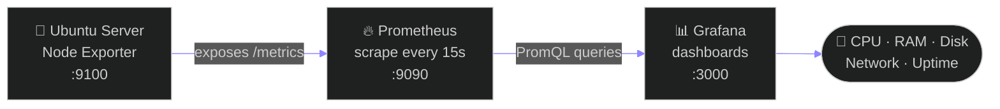
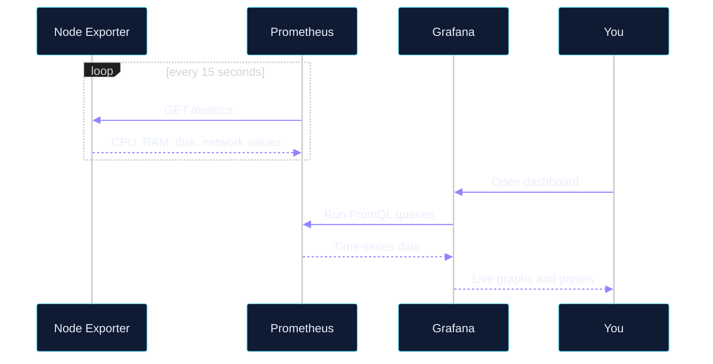
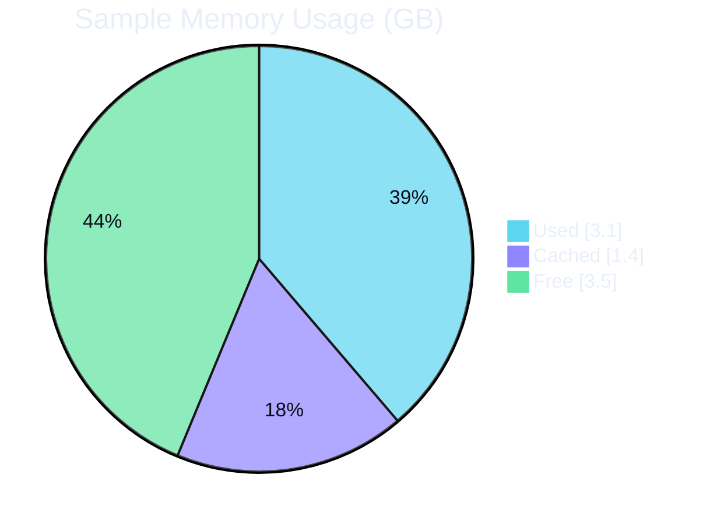

<div align="center">


<br/>


</div>

<br/>

## 📌 Table of Contents

- [Overview](#-overview)
- [Architecture](#-architecture)
- [Dashboard Preview](#-dashboard-preview)
- [What Gets Monitored](#-what-gets-monitored)
- [Setup Guide](#-setup-guide)
- [PromQL Queries](#-promql-queries)
- [Troubleshooting](#-troubleshooting)
- [What I Learned](#-what-i-learned)
- [Future Improvements](#-future-improvements)
- [Contact](#-contact)

---

## 🎯 Overview

This project builds a complete monitoring stack for a Linux server running on Ubuntu (WSL).

| Component | Role | Default Port |
|---|---|---|
| **Node Exporter** | Collects hardware and OS metrics from the server | `9100` |
| **Prometheus** | Scrapes, stores and queries time-series metrics | `9090` |
| **Grafana** | Turns metrics into live dashboards | `3000` |

The result is a single dashboard that shows the health of the server at a glance: CPU, RAM, disk, network traffic and uptime.

---

## 🏗️ Architecture



### How data flows



---

## 🖥️ Dashboard Preview

A text preview of the dashboard layout (sample values, for illustration):

```text
╔══════════════════════════════════════════════════════════════════╗
║  📊  Linux Server Overview                     ● Live  ⟳ 15s    ║
╠══════════════╦══════════════╦══════════════╦═════════════════════╣
║  🧠 CPU      ║  💾 RAM      ║  🗄️ DISK /   ║  ⏱️ UPTIME          ║
║              ║              ║              ║                     ║
║    23 %      ║    39 %      ║    41 %      ║    4d 12h 08m       ║
║  ▓▓░░░░░░░░  ║  ▓▓▓▓░░░░░░  ║  ▓▓▓▓░░░░░░  ║                     ║
╠══════════════╩══════════════╩══════════════╩═════════════════════╣
║  🌐 Network traffic (last 1h)                                    ║
║                                                                  ║
║   ↓ in   ▁▂▃▅▃▂▃▄▆▅▃▂▃▄▅▃▂▁▂▃▄▃▂▁▂▃▅▆▄▃▂▃▄▃▂                    ║
║   ↑ out  ▁▁▂▂▁▁▂▃▂▁▁▂▂▃▂▁▁▂▂▁▁▂▃▃▂▁▁▂▂▁▁▂▂▁                    ║
╚══════════════════════════════════════════════════════════════════╝
```

Sample resource split for the monitored server:



---

## ✨ What Gets Monitored

| Metric | What it shows | Why it matters |
|---|---|---|
| 🧠 **CPU** | Usage across all cores | Spots overloaded servers and runaway processes |
| 💾 **Memory** | Used vs available RAM | Detects memory leaks and low-memory risk |
| 🗄️ **Disk** | Space used per filesystem | Prevents "disk full" outages |
| 🌐 **Network** | Incoming and outgoing traffic | Shows unusual traffic and bandwidth use |
| ⏱️ **Uptime** | Time since last boot | Confirms stability and reveals unexpected reboots |

---

## 🚀 Setup Guide

> Tested on **Ubuntu (WSL)**. These steps also work on a regular Ubuntu server.

<details open>
<summary><b>Step 1: Install Prometheus and Node Exporter</b></summary>

<br/>

```bash
sudo apt update
sudo apt install -y prometheus prometheus-node-exporter
```

Check that Node Exporter is exposing metrics:

```bash
curl -s http://localhost:9100/metrics | head
```

</details>

<details>
<summary><b>Step 2: Configure Prometheus</b></summary>

<br/>

Edit `/etc/prometheus/prometheus.yml`:

```yaml
global:
  scrape_interval: 15s

scrape_configs:
  - job_name: "prometheus"
    static_configs:
      - targets: ["localhost:9090"]

  - job_name: "node"
    static_configs:
      - targets: ["localhost:9100"]
```

Restart and verify:

```bash
sudo systemctl restart prometheus
sudo systemctl status prometheus
```

Open `http://localhost:9090/targets`. Both targets should show **UP**.

</details>

<details>
<summary><b>Step 3: Install Grafana</b></summary>

<br/>

```bash
sudo apt-get install -y apt-transport-https software-properties-common wget
sudo mkdir -p /etc/apt/keyrings/
wget -q -O - https://apt.grafana.com/gpg.key | gpg --dearmor | sudo tee /etc/apt/keyrings/grafana.gpg > /dev/null
echo "deb [signed-by=/etc/apt/keyrings/grafana.gpg] https://apt.grafana.com stable main" | sudo tee /etc/apt/sources.list.d/grafana.list
sudo apt-get update
sudo apt-get install -y grafana

sudo systemctl enable --now grafana-server
```

</details>

<details>
<summary><b>Step 4: Connect Grafana to Prometheus</b></summary>

<br/>

1. Open `http://localhost:3000` (default login: `admin` / `admin`, you will be asked to change it).
2. Go to **Connections → Data sources → Add data source → Prometheus**.
3. Set the URL to `http://localhost:9090`.
4. Click **Save & test**. You should see a success message.

</details>

<details>
<summary><b>Step 5: Build the dashboard</b></summary>

<br/>

1. Go to **Dashboards → New → New dashboard → Add visualization**.
2. Select the Prometheus data source.
3. Add one panel per metric using the queries in the next section.
4. Set the refresh interval to **15s** and save the dashboard.

> 💡 Faster option: **Dashboards → New → Import**, enter dashboard ID `1860` (Node Exporter Full) and choose your Prometheus data source.

</details>

<details>
<summary><b>WSL note: if services do not start</b></summary>

<br/>

Older WSL setups do not run `systemd` by default. Enable it by adding this to `/etc/wsl.conf`:

```ini
[boot]
systemd=true
```

Then run `wsl --shutdown` in Windows PowerShell and reopen Ubuntu.

</details>

---

## 🔎 PromQL Queries

These are the queries behind each dashboard panel.

| Panel | Query |
|---|---|
| 🧠 **CPU usage %** | `100 - (avg(rate(node_cpu_seconds_total{mode="idle"}[5m])) * 100)` |
| 💾 **Memory usage %** | `(1 - node_memory_MemAvailable_bytes / node_memory_MemTotal_bytes) * 100` |
| 🗄️ **Disk usage %** | `100 - (node_filesystem_avail_bytes{mountpoint="/",fstype!="tmpfs"} / node_filesystem_size_bytes{mountpoint="/",fstype!="tmpfs"} * 100)` |
| 🌐 **Network in** | `rate(node_network_receive_bytes_total{device!="lo"}[5m])` |
| 🌐 **Network out** | `rate(node_network_transmit_bytes_total{device!="lo"}[5m])` |
| ⏱️ **Uptime** | `time() - node_boot_time_seconds` |

---

## 🛠️ Troubleshooting

| Problem | Likely cause | Fix |
|---|---|---|
| Target shows **DOWN** in Prometheus | Node Exporter not running | `sudo systemctl status prometheus-node-exporter` |
| Grafana says "data source not found" | Wrong Prometheus URL | Use `http://localhost:9090` |
| Dashboard panels show **No data** | Wrong time range or query | Set the range to *Last 15 minutes* and check the query in Prometheus first |
| Port already in use | Another service on the same port | `sudo ss -tulpn \| grep -E '9090\|9100\|3000'` |
| Services stop after reboot | Not enabled on boot | `sudo systemctl enable prometheus prometheus-node-exporter grafana-server` |

---

## 📁 Project Structure

```text
.
├── prometheus.yml    # Prometheus scrape configuration
└── README.md         # Project documentation
```

---

## 📚 What I Learned

- How a monitoring pipeline works: expose, scrape, store, visualize
- Writing PromQL queries for CPU, memory, disk and network
- Managing Linux services with `systemctl` and reading their status and logs
- Troubleshooting connectivity between services using ports and `curl`
- Designing a dashboard that makes server health obvious in seconds

---

## 🔮 Future Improvements

- [ ] Add **Alertmanager** with alerts for high CPU and low disk space
- [ ] Monitor multiple servers from one Prometheus instance
- [ ] Run the whole stack with **Docker Compose**
- [ ] Add Windows server metrics with `windows_exporter`
- [ ] Export the dashboard as JSON and store it in the repo

---

## 📫 Contact

<div align="center">

<a href="https://rafandxb-portfolio.netlify.app/"></a>
<a href="https://www.linkedin.com/in/rafan-rahuf-ab450636b"></a>
<a href="mailto:rafanrahuf@gmail.com"></a>
<a href="https://github.com/rafan-coder"></a>

<br/><br/>

<sub>Built by Rafan A, Junior IT Infrastructure Engineer</sub>

</div>


